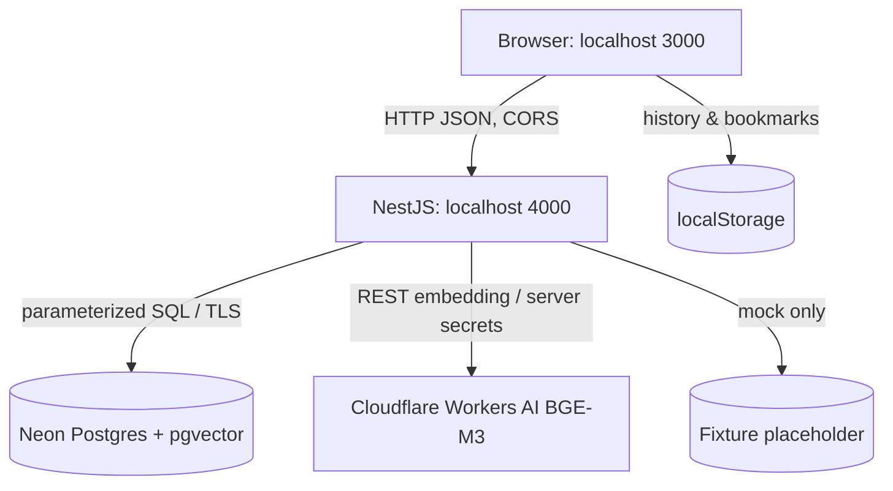

# 03 — Architecture Decision

## Mengapa backend NestJS?
Pencarian gabungan, koneksi DB, kontrol API token, verifikasi sumber, indexing, rate limiting dan observability adalah bisnis server. Next.js tidak boleh memanggil Neon atau Cloudflare AI dari browser. NestJS memakai controller/service/repository/provider untuk memisahkan tanggung jawab dan memudahkan pengujian. Deployment **belum diputuskan**.

## Diagram lokal


## Repository
```
matanexa/
  AGENTS.md, README.md, TASKS.md
  package.json                 # npm workspaces + scripts
  apps/
    web/                       # Next.js App Router; components, hooks, state
      app/, components/, features/search/, lib/api-client.ts
      .env.local.example
    api/                       # NestJS server
      src/main.ts
      src/modules/health/
      src/modules/search/      # SearchController, SearchService, DTOs
      src/modules/hadiths/
      src/modules/sources/
      src/database/            # pg pool, repositories, migrations
      src/providers/embedding/ # CF REST adapter/mock
      .env.example
  packages/
    contracts/                 # optional shared DTO types/schemas only
  db/                          # SQL migrations
  tests/                       # evaluation queries, tests
  docs/
```

## Runtime
- `next dev` on 3000; `nest start --watch` on 4000, launched by root `npm run dev`.
- Frontend uses `NEXT_PUBLIC_API_BASE_URL=http://localhost:4000/api/v1` (**URL only**, not a secret).
- Backend `.env`: `APP_SEARCH_MODE`, `DATABASE_URL` (for lexical/hybrid), `CLOUDFLARE_ACCOUNT_ID`, `CLOUDFLARE_API_TOKEN` (hybrid only).
- API health returns mode and DB config readiness (no secrets).
- Next.js App Router kept; no Next route handlers or server actions for search. Do **not** force Next static export yet; leave hosting choice for future.
- `pg` driver/pool with small pool (<=3 initially), SSL required to remote Neon; SQL files committed, app executes migrations manually through a script, not PG local CLI.
- API DTO validation via class-validator/class-transformer or Zod consistently; global exception filter; permissive local CORS only explicit localhost origins.
- GET endpoints idempotent; POST search because complex filter JSON. Client abort requests when query replaced.

## Architectural interface boundaries
`SearchController` -> `SearchService` -> `LexicalRetriever` + `VectorRetriever` -> `FusionRanker` -> `HadithRepository` -> verified DTO only. `EmbeddingProvider` injectable with real/mock implementations, so tests need no Cloudflare account.

## Standard response envelope
`{ data: ..., meta: ..., error?: never }` for success; `{ error: { code, message, requestId } }` for failure. Explicit `modeUsed`: mock, lexical, hybrid, or lexical_fallback.

## ADR
We deliberately postpone shipping code/deploy configs for hosting; no assumption of Render, Cloudflare Pages, Vercel SSR, or free tier workarounds while user is validating locally.
